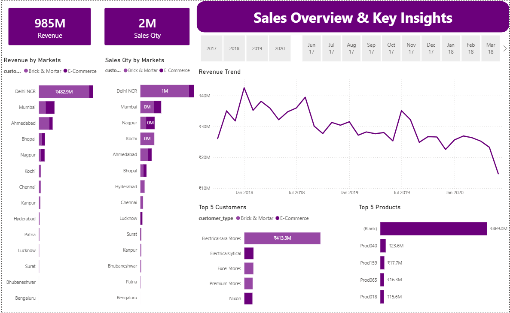
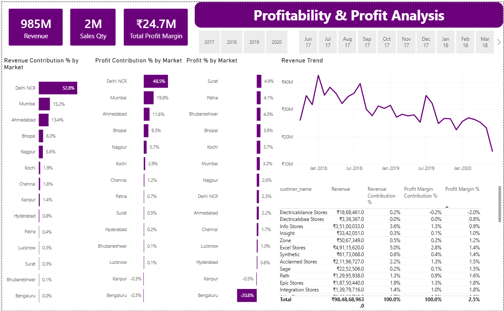
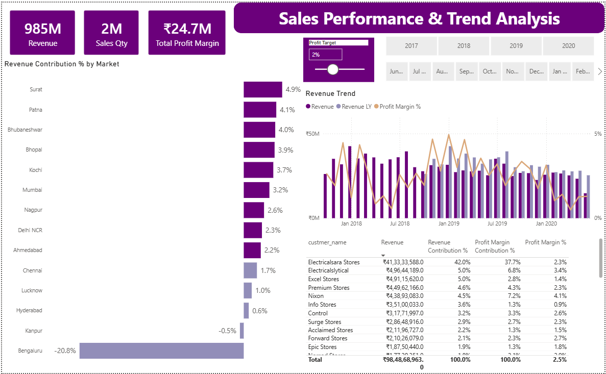

# 📊 Sales-Insights-Analysis-SQL-PowerBI
End-to-end Sales Insights Analysis project using MySQL and Power BI to analyze sales, revenue, market performance, and profitability through SQL queries and interactive dashboards.

## 📌 Project Overview

Sales Insights Analysis is an end-to-end data analytics project developed using **MySQL, SQL, and Microsoft Power BI**. The project focuses on analyzing sales data to understand revenue, sales quantity, market performance, customer contribution, and profitability.

Data is retrieved from a MySQL database using SQL and presented through an interactive, three-page Power BI dashboard to support data-driven business decisions.

## 🎯 Project Objectives

* Analyze overall revenue and sales quantity.
* Identify top-performing markets and customers.
* Evaluate revenue and profit contribution across markets.
* Analyze profit margins and profitability.
* Track monthly revenue and sales performance trends.
* Present business insights through interactive dashboards.

## 🛠️ Tools & Technologies

* **MySQL** — Database management and data storage
* **SQL** — Data extraction, querying, aggregation, and analysis
* **Microsoft Power BI** — Dashboard development and reporting
* **Power Query** — Data transformation and preparation
* **DAX** — Measures and KPI calculations
* **Data Visualization** — Interactive charts, tables, and filters

## 📈 Dashboard Pages

### 1. Sales Overview & Key Insights

* Total Revenue and Sales Quantity KPIs
* Revenue by Market
* Sales Quantity by Market
* Monthly Revenue Trend
* Top 5 Customers by Revenue
* Top 5 Products by Revenue
* Year and Month Filters

### 2. Profitability & Profit Analysis

* Revenue, Sales Quantity, and Total Profit Margin KPIs
* Revenue Contribution Percentage by Market
* Profit Contribution Percentage by Market
* Profit Percentage by Market
* Monthly Revenue Trend
* Customer-Level Revenue and Profit Margin Analysis

### 3. Sales Performance & Trend Analysis

* Market-Wise Revenue Contribution
* Monthly Revenue Comparison
* Revenue and Previous-Year Revenue Analysis
* Profit Margin Percentage Trend
* Interactive Profit Target Parameter
* Customer Performance Table

## 🔍 Key Insights

* Delhi NCR represents the largest revenue-contributing market in the displayed overview.
* Revenue fluctuates over the reporting period, with a noticeable decline toward the end of the displayed timeline.
* Revenue and profit contributions vary across markets.
* Customer-level analysis provides insights into revenue contribution and profitability.
* The interactive profit target parameter supports performance comparison against a selected target.

## 📸 Dashboard Screenshots

### Sales Overview & Key Insights



### Profitability & Profit Analysis



### Sales Performance & Trend Analysis



## 📂 Project Structure

```text
Sales-Insights-Analysis-SQL-PowerBI/
│
├── README.md
├── Sales-Insights-Analysis.pbix
│── sales_insights_queries.sql
├── key-insights.png
├── profit-analysis.png
└── performance-insights.png
```

## 💡 Skills Demonstrated

* SQL Query Writing
* MySQL Database Connectivity
* Data Extraction and Analysis
* Power BI Dashboard Development
* Power Query Data Transformation
* DAX Measures and KPI Creation
* Data Visualization
* Business Intelligence
* Interactive Reporting

## 👨‍💻 Author

**Sai Suryawanshi**

* **LinkedIn:** [Connect with me](https://www.linkedin.com/in/sai-suryawanshi-6351a6321/)
* **GitHub:** [Explore my repositories](https://github.com/suryawanshisai)

---


